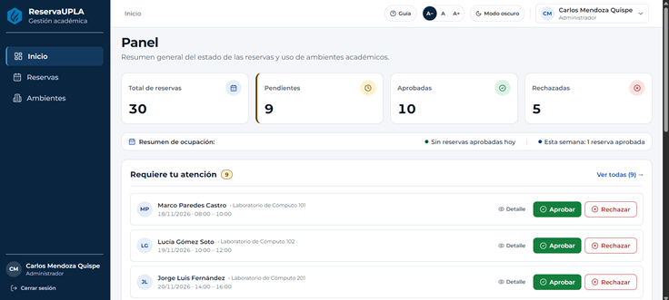
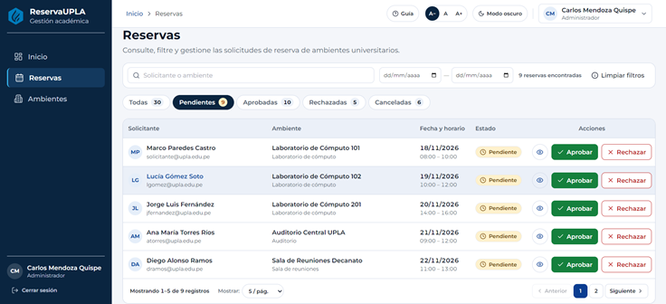
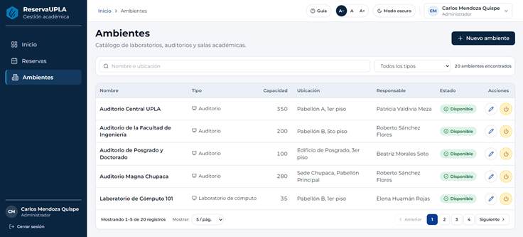
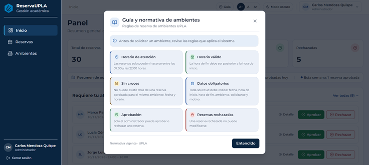

# ReservaUPLA — Sistema de Gestión de Reservas de Ambientes Universitarios

[](https://github.com/Alfonso0712/ReservaUPLA/actions/workflows/ci.yml)

Aplicación web para registrar, validar, aprobar, consultar y supervisar solicitudes de reserva de ambientes académicos (laboratorios de cómputo, laboratorios especializados, auditorios y salas de reuniones) en la **Universidad Peruana Los Andes (UPLA)**.

---

## 1. Problema que resuelve

La coordinación manual de laboratorios y auditorios universitarios genera cruces de horarios, falta de trazabilidad sobre quién autorizó cada uso y desconocimiento de la disponibilidad real por pabellón. **ReservaUPLA** centraliza el flujo completo desde la solicitud docente o estudiantil hasta la resolución administrativa, garantizando mediante transacciones serializables y reglas de dominio que nunca existan dos reservas aprobadas superpuestas para el mismo ambiente.

---

## 2. Funcionalidades (RF-01 a RF-08)

| Código | Funcionalidad | Descripción |
| :--- | :--- | :--- |
| **RF-01** | Registro y autenticación de usuarios | Autoregistro de solicitantes con correo institucional `@upla.edu.pe` e inicio de sesión por roles (`Administrador`, `Responsable`, `Solicitante`). |
| **RF-02** | Gestión de ambientes académicos | Catálogo de ambientes con nombre, tipo, capacidad, ubicación, responsable asignado y estado operativo (`Disponible`, `Mantenimiento`, `Inactivo`). |
| **RF-03** | Registro de solicitud de reserva | Creación de solicitudes indicando ambiente, fecha, hora de inicio, hora de fin y motivo académico (estado inicial `Pendiente`). |
| **RF-04** | Validación y consulta de disponibilidad | Verificación automática de disponibilidad por ambiente y fecha para impedir solapamientos horarios. |
| **RF-05** | Consulta y filtrado de reservas | Listado paginado con búsqueda por solicitante o ambiente, filtro por rango de fechas y pestañas por estado. |
| **RF-06** | Detalle de reserva | Vista detallada de la solicitud con información del ambiente, solicitante, horario, estado actual y alerta de posibles conflictos. |
| **RF-07** | Aprobación, rechazo y cancelación | Flujo de decisión con confirmación para aprobar o rechazar solicitudes (`Administrador`) y cancelación de solicitudes propias (`Solicitante`). |
| **RF-08** | Panel de indicadores (Dashboard) | Resumen operativo con total de reservas, pendientes, aprobadas, rechazadas, tasa de aprobación, ambiente más utilizado y reservas por día. |
| **Módulo Usuarios** | Gestión de usuarios (Exclusivo Administrador) | Listado con búsqueda por nombre/correo, filtros por rol y estado, alta con clave inicial, edición de nombre/rol y activación/desactivación lógica. |

---

## 3. Reglas de Negocio (RN-01 a RN-06)

| Código | Regla de Negocio | Implementación en el Sistema |
| :--- | :--- | :--- |
| **RN-01** | **Sin cruces de horarios** | No puede existir más de una reserva en estado `Aprobada` para el mismo ambiente en un rango de fecha y hora que se superponga (`Hin < HfiExistente && Hfi > HinExistente`). |
| **RN-02** | **Datos obligatorios** | Toda solicitud exige fecha, hora de inicio, hora de fin, motivo (entre 10 y 300 caracteres), ambiente válido y solicitante autenticado. |
| **RN-03** | **Horario válido** | La hora de fin debe ser estrictamente posterior a la hora de inicio (`HoraFin > HoraInicio`), sin permitir fechas pasadas. |
| **RN-04** | **Horario de atención institucional** | Las reservas solo pueden registrarse dentro de la franja horaria de **07:00 a 22:00 horas**. |
| **RN-05** | **Aprobación exclusiva** | Únicamente el rol `Administrador` posee los permisos `reservas.aprobar` y `reservas.rechazar` para resolver solicitudes pendientes. |
| **RN-06** | **Inmutabilidad de reservas cerradas** | Una reserva en estado `Rechazada` o `Cancelada` constituye un estado final irreversible y no puede volver a modificarse. |

---

## 4. Stack Tecnológico

| Capa | Tecnología | Versión Exacta |
| :--- | :--- | :--- |
| **Backend (API & Dominio)** | .NET / ASP.NET Core Web API | `8.0` (`net8.0`) |
| **ORM y Proveedor BD** | Entity Framework Core / Npgsql | `8.0.11` |
| **Documentación OpenAPI** | Swashbuckle.AspNetCore (Swagger) | `6.6.2` |
| **Base de Datos** | PostgreSQL | `16` (puerto `5432`, BD `ReservasUPLA_DB`) |
| **Frontend** | React + Vite | React `18.3.1` · Vite `8.3.5` |
| **Enrutamiento y Estilos** | React Router DOM / Tailwind CSS / Lucide | Router `6.28.0` · Tailwind `3.4.3` · Lucide `0.460.0` |
| **Pruebas Automatizadas** | xUnit + Moq (Backend) / Vitest + Testing Library (Frontend) | xUnit `2.5.3` · Vitest `3.2.7` · RTL `16.3.3` |
| **Calidad y Accesibilidad** | ESLint + `eslint-plugin-jsx-a11y` (WCAG 2.2 AA) | ESLint `9.39.5` · jsx-a11y `6.10.2` |

---

## 5. Arquitectura del Proyecto

El backend implementa **Clean Architecture** dividida en 4 proyectos independientes, y el frontend sigue una **arquitectura modular** por responsabilidades:

```text
ReservaUPLA/
├── .github/workflows/
│   └── ci.yml                       # Pipeline de Integración Continua (backend + frontend)
├── backend/
│   ├── ReservaUpla.Domain/          # Entidades ricas, Enums, Excepciones, Constantes y Políticas RBAC
│   ├── ReservaUpla.Application/     # Casos de uso (Services), DTOs, Mappers e Interfaces de repositorios
│   ├── ReservaUpla.Infrastructure/  # AppDbContext (EF Core), Migraciones, Repositorios, Hasher y Seeder
│   ├── ReservaUpla.Api/             # Controladores REST, Middlewares, Rate Limiting y Cookies HttpOnly
│   ├── scripts/
│   │   └── crear_rol_app.sql        # Creación del rol PostgreSQL reservas_app de mínimo privilegio
│   ├── Dockerfile                   # Construcción multi-stage con ejecución bajo usuario no-root
│   └── README-seguridad.md          # Guía de configuración segura de credenciales y privilegios
├── docs/
│   ├── database/
│   │   └── init/                    # Script idempotente de migraciones e inicialización del rol restringido
│   ├── hooks/
│   │   └── pre-commit               # Hook que bloquea commits con contraseñas o secretos incrustados
│   └── img/                         # Capturas de pantalla de la interfaz del sistema
├── frontend/
│   ├── src/
│   │   ├── components/              # Componentes UI accesibles, formularios, navegación, ambientes y reservas
│   │   ├── constants/               # Reglas, estados, mensajes, permisos, rutas y normativa institucional
│   │   ├── context/                 # Contexto de preferencias de usuario (tema claro/oscuro y escala A-/A/A+)
│   │   ├── hooks/                   # Hooks de sesión (useAuth), permisos, formularios, debounce y trampa de foco
│   │   ├── layouts/                 # Layouts de autenticación y panel administrativo
│   │   ├── mocks/                   # Adaptador mock en memoria para pruebas aisladas (VITE_USAR_MOCK)
│   │   ├── pages/                   # Vistas: Ingresar, Registro, Panel, ListadoReservas, DetalleReserva, Ambientes, Usuarios
│   │   ├── services/                # Cliente HTTP con AbortController y servicios REST por módulo
│   │   ├── styles/                  # Tokens de diseño CSS y configuración de temas
│   │   ├── tests/                   # 24 suites de pruebas automatizadas (Vitest + Testing Library)
│   │   ├── utils/                   # Formateadores de fechas, horas, iniciales y ordenamiento tabular
│   │   └── validation/              # Validadores de cliente alineados con las reglas RN-01..RN-06
│   └── Dockerfile                   # Build estático de Vite servido con Nginx en el puerto 5173
├── tests/
│   └── ReservaUpla.Tests/           # 108 pruebas unitarias, de concurrencia e integración en xUnit
├── .env.example                     # Plantilla de variables de entorno con marcadores <CONTRASENA_AQUI>
├── .gitignore                       # Exclusión de binarios, dependencias, respaldos y archivos .env
├── CHANGELOG.md                     # Historial de versiones en formato Keep a Changelog
├── README.md                        # Documentación principal del proyecto
├── ReservaUpla.sln                  # Solución principal de .NET 8
└── docker-compose.yml               # Orquestación de PostgreSQL (db), API (.NET 8) y Web (React/Nginx)
```

---

## 6. Cómo ejecutar con Docker (Recomendado)

1. Copie la plantilla de variables de entorno y asigne contraseñas locales en el archivo `.env` (ignorado por Git):
   ```bash
   cp .env.example .env
   ```
   Edite `.env` reemplazando `<CONTRASENA_AQUI>` en `POSTGRES_PASSWORD` y `DB_APP_PASSWORD`.
2. Levante los 3 contenedores (`db`, `api` y `web`):
   ```bash
   docker compose up --build -d
   ```
3. Acceda a la aplicación en su navegador:
   - **Frontend Web**: [http://localhost:5173](http://localhost:5173)
   - **API / Swagger UI**: [http://localhost:5000/swagger](http://localhost:5000/swagger)

> **Modo demostración solo frontend (opcional, sin base de datos)**:
> ```bash
> docker compose --profile mock up --build frontend-mock
> ```

---

## 7. Cómo ejecutar sin Docker (Entorno Local)

### Requisitos previos
- **.NET 8 SDK** (`8.0.x`), **Node.js** (`>= 20.x`) y **PostgreSQL** (`>= 15`) con una base de datos llamada `ReservasUPLA_DB`.

### Paso 1: Configurar base de datos y secretos del Backend
1. Aplique las migraciones con una cuenta administradora de esquema:
   ```bash
   ConnectionStrings__DefaultConnection="Host=localhost;Port=5432;Database=ReservasUPLA_DB;Username=postgres;Password=<CONTRASENA_AQUI>" dotnet ef database update --project backend/ReservaUpla.Infrastructure --startup-project backend/ReservaUpla.Api
   ```
2. Ejecute el script [`backend/scripts/crear_rol_app.sql`](backend/scripts/crear_rol_app.sql) en PostgreSQL (reemplazando `<CONTRASENA_AQUI>`) para crear el rol de mínimo privilegio `reservas_app`.
3. Configure **User Secrets** en el proyecto `ReservaUpla.Api` e inicie el servidor en el puerto `5000`:
   ```bash
   dotnet user-secrets set "ConnectionStrings:DefaultConnection" "Host=localhost;Port=5432;Database=ReservasUPLA_DB;Username=reservas_app;Password=<CONTRASENA_AQUI>" --project backend/ReservaUpla.Api
   dotnet run --project backend/ReservaUpla.Api --launch-profile http
   ```

### Paso 2: Iniciar el Frontend
En otra terminal, instale las dependencias y levante el servidor de desarrollo de Vite en el puerto `5173` (el proxy de Vite redirige `/api` hacia `http://localhost:5000`):
```bash
cd frontend
npm install
npm run dev
```

---

## 8. Cómo correr las pruebas automatizadas

Las suites de pruebas se ejecutan en memoria y con adaptador simulado, por lo que **no requieren tener PostgreSQL en ejecución**:

### Backend (108 pruebas en xUnit)
```bash
dotnet test ReservaUpla.sln
```

### Frontend (89 pruebas en 24 suites con Vitest + Linter de Accesibilidad)
```bash
npm --prefix frontend run lint
VITE_USAR_MOCK=true npm --prefix frontend test -- --run
```
*(En PowerShell: `$env:VITE_USAR_MOCK='true'; npm --prefix frontend test -- --run`)*

---

## 9. Usuarios de Demostración

Al iniciar en entorno `Development` con la base de datos vacía, `DatabaseSeeder` registra automáticamente las cuentas de demostración:

| Rol en el Sistema | Correo Institucional | Alcance de Permisos |
| :--- | :--- | :--- |
| **Administrador** | `admin@upla.edu.pe` | Gestión completa de ambientes, aprobación/rechazo/cancelación de reservas y panel global. |
| **Responsable** | `responsable@upla.edu.pe` | Supervisión de indicadores y reservas de los ambientes bajo su responsabilidad. |
| **Solicitante** | `solicitante@upla.edu.pe` | Creación de solicitudes de reserva, consulta de disponibilidad y cancelación de reservas propias. |

> **Nota de seguridad**: Por política de seguridad del repositorio, **las contraseñas de prueba no se publican en este documento**. Consulte la sección de credenciales de prueba en el **Informe Técnico** entregado al docente.

---


### Endpoints de Gestión de Usuarios (Exclusivo Administrador)
| Método | Ruta | Descripción | Rol Requerido |
| :--- | :--- | :--- | :--- |
| GET | /api/usuarios/admin | Listado paginado con búsqueda por nombre/correo y filtros de rol y estado | Administrador |
| POST | /api/usuarios/admin | Alta administrativa de usuario (Responsable o Solicitante) con clave inicial | Administrador |
| PUT | /api/usuarios/{id} | Edición de nombre completo y rol (con validación de ambientes asignados) | Administrador |
| PATCH | /api/usuarios/{id}/estado | Activación o desactivación lógica de usuario | Administrador |

---

## 10. Seguridad

El proyecto aplica controles de seguridad en todas sus capas (detalle completo en [`backend/README-seguridad.md`](backend/README-seguridad.md)):

- **Cero secretos en el repositorio**: Las cadenas de conexión se inyectan por `dotnet user-secrets` o por la variable de entorno `ConnectionStrings__DefaultConnection`. Incluye el hook [`docs/hooks/pre-commit`](docs/hooks/pre-commit) (`git config core.hooksPath docs/hooks`) para bloquear commits con credenciales.
- **Principio de menor privilegio en BD**: La API opera con el rol `reservas_app` (`SELECT`, `INSERT`, `UPDATE`), sin permisos `DELETE`, `DDL` ni `SUPERUSER`.
- **Autenticación y sesión segura**: Hash de contraseñas con **PBKDF2 HMAC-SHA256** (sal de 128 bits, 100,000 iteraciones), mitigación contra ataques de temporización (`VerifyDummyPassword`), cookies `HttpOnly` + `SameSite=Lax` y *Rate Limiting* por IP en `/api/auth/login`.
- **Manejo centralizado de errores**: Respuestas uniformes RFC 7807 (`ProblemDetails`) sin exponer *stack traces* al cliente.

---

## 11. Estructura de Ramas y Convención de Commits

- **Ramas**:
  - `main`: Rama estable de entregas y versiones etiquetadas (`v0.0.0` – `v0.9.0`).
  - `develop`: Rama de integración de fases evolutivas.
  - `feature/*`, `fix/*`, `security/*`, `docs/*`: Ramas temáticas por requerimiento o corrección.
- **Commits**: Se aplica la especificación **Conventional Commits** (`feat:`, `fix:`, `refactor:`, `style:`, `test:`, `security:`, `docs:`, `chore:`, `ci:`).

---

## 12. Capturas del Sistema

### Panel de Indicadores (Dashboard)


### Gestión y Filtrado de Reservas


### Catálogo de Ambientes Universitarios


### Guía y Normativa Institucional

